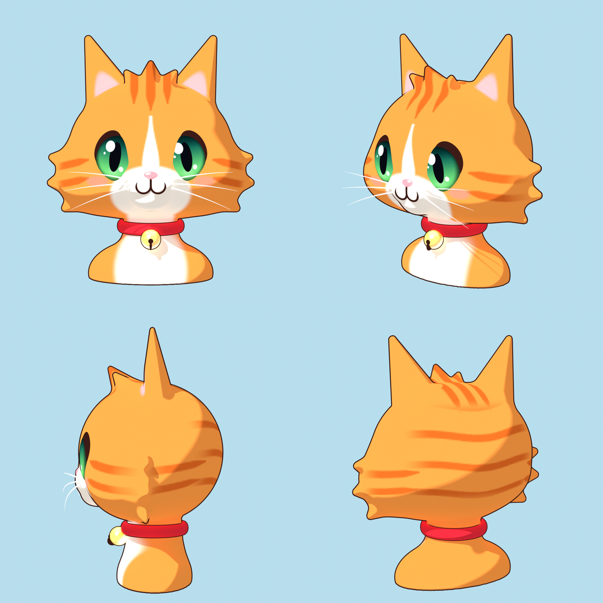

# Vtube-test

โมเดลหัวแมวสไตล์อนิเมะ ปั้นด้วยสคริปต์ Blender (ไม่ต้องเปิดโปรแกรม Blender)



## ไฟล์

| ไฟล์ | ใช้ทำอะไร |
|---|---|
| `cat/build_cat.py` | สคริปต์ปั้นโมเดลทั้งหมด |
| `cat/out/cat_head.blend` | เปิดแก้ต่อใน Blender 5.x (มี cel shading + เส้นขอบสำหรับ Cycles) |
| `cat/out/cat_head.glb` | glTF สำหรับเอาไปใช้ที่อื่น (สีขนเป็น vertex colour, ตาเป็น texture) |
| `cat/out/render_*.png`, `preview.png` | ภาพเรนเดอร์ 4 มุม |
| `cat/out/turntable.mp4` | วิดีโอหมุนรอบตัว |

## สร้างใหม่

```bash
python -m venv .venv && .venv/bin/pip install -r cat/requirements.txt
.venv/bin/python cat/build_cat.py              # โมเดล + ภาพ 4 มุม
.venv/bin/python cat/build_cat.py --turntable  # เพิ่มเฟรมหมุนรอบตัว
```

เปลี่ยนสีได้ที่ค่าคงที่ด้านบนของสคริปต์ (`FUR`, `FUR_DARK`, `IRIS_TOP`, ...)
รูปทรงอยู่ในฟังก์ชัน `cat_sdf` ส่วนลายขนอยู่ใน `fur_colours`

## ยังไม่ได้ทำ

- กระดูก (rig) และ blendshape สำหรับกะพริบตา/ขยับปาก
- ส่งออก `.vrm`
- retopology: ตัวขนเป็น mesh จาก voxel remesh ประมาณ 110k quads
