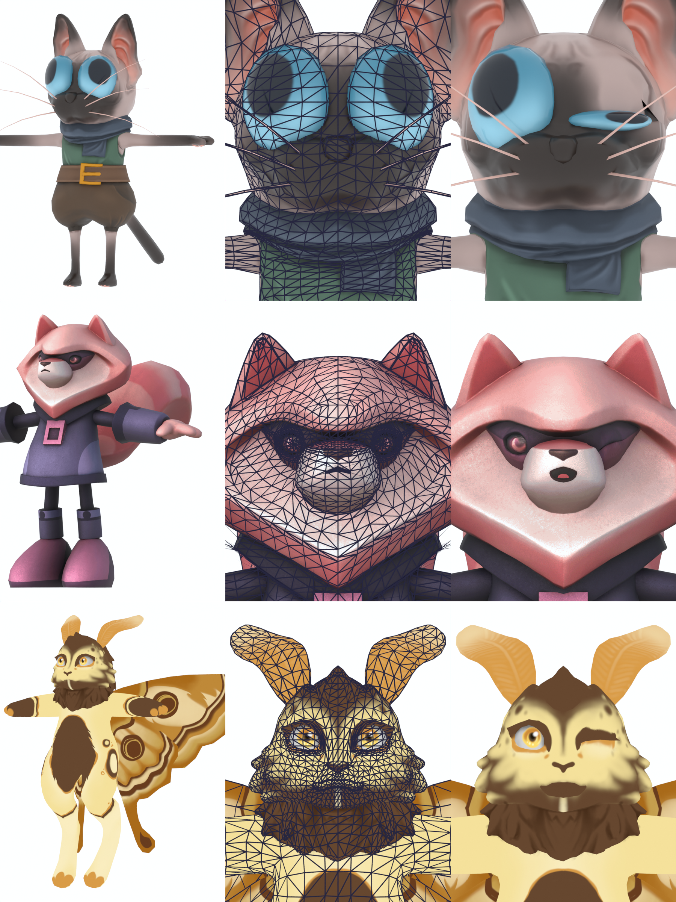

# Avatar อ้างอิง (CC0) และสิ่งที่เรียนรู้

ไฟล์ใน `vrm/` มาจากคอลเลกชัน 100Avatars R3 บน [Open Source Avatars](https://www.opensourceavatars.com/)
ในไฟล์ระบุ license เป็น CC0 และ commercial use: Allow

แต่ละแถว: เต็มตัว / โครง mesh ที่หัว / ทดสอบ blendshape (หลับตาซ้าย + ปาก "อา")

## ตัวเลขจากไฟล์จริง (`python reference/vrm_inspect.py reference/vrm/*.vrm`)

| | WeirdCat | MeganTheFox | CatMoth |
|---|---|---|---|
| สามเหลี่ยม | 6,640 | 10,426 | 8,030 |
| mesh / material | 1 / 1 | 1 / 1 | 1 / 1 |
| texture | 3 | 1 | 1 |
| กระดูกทั้งหมด | 58 | 46 | 51 |
| กระดูก humanoid ที่จับคู่ | 40 | 40 | 28 |
| blendshape บน mesh | 11 | 14 | 11 |
| spring bone (หาง/หู) | 3 | 1 | 6 |

## โมเดล VTuber ที่ใช้ได้ต้องมีอะไร

1. **Mesh เบา ชิ้นเดียว** ราว 6,000-10,000 สามเหลี่ยม เส้น mesh วนรอบตาและปาก
2. **Texture แผ่นเดียว** สีทั้งหมดวาดลง texture (ไม่ใช้ vertex colour)
3. **โครงกระดูก humanoid** ท่า T-pose อย่างน้อย hips, spine, chest, neck, head, แขน ขา
4. **Blendshape 11 ตัว** กะพริบตาซ้าย/ขวา, ปาก a i u e o, joy, angry, sorrow, fun
5. **ข้อมูล VRM** จับคู่กระดูก, จับคู่ blendshape เข้ากับ preset, spring bone, meta/license

## เทียบกับโมเดลที่เราปั้นเอง

| | หัวแมว (`cat/`) | ที่ต้องเป็น |
|---|---|---|
| สามเหลี่ยม | ราว 220,000 | ไม่เกิน 10,000 |
| สี | vertex colour | texture + UV |
| กระดูก | ไม่มี | humanoid |
| blendshape | ไม่มี | 11 ตัว |
| ลำตัว แขน ขา | ไม่มี | มี |
